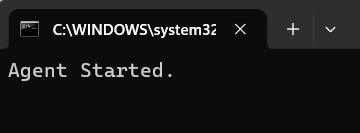

## Java Mouse Mover

Java Mouse Mover (from here: **MM**) is a simple CLI (command line interface) utility designed 
to move mouse periodically to avoid timeout issue in some situation or also black screen for inactivity.

Usage:

> <code>java -jar MM.jar [txt]</code>

where *[txt]* is a string to display in terminal when app starts

For example, launching MM with the following arguments:

<code>java -jar MM.jar Agent</code>

opens a terminal similar to this:

 

Java Mouse Mover runs with any JRE/JDK 11 or greater 
